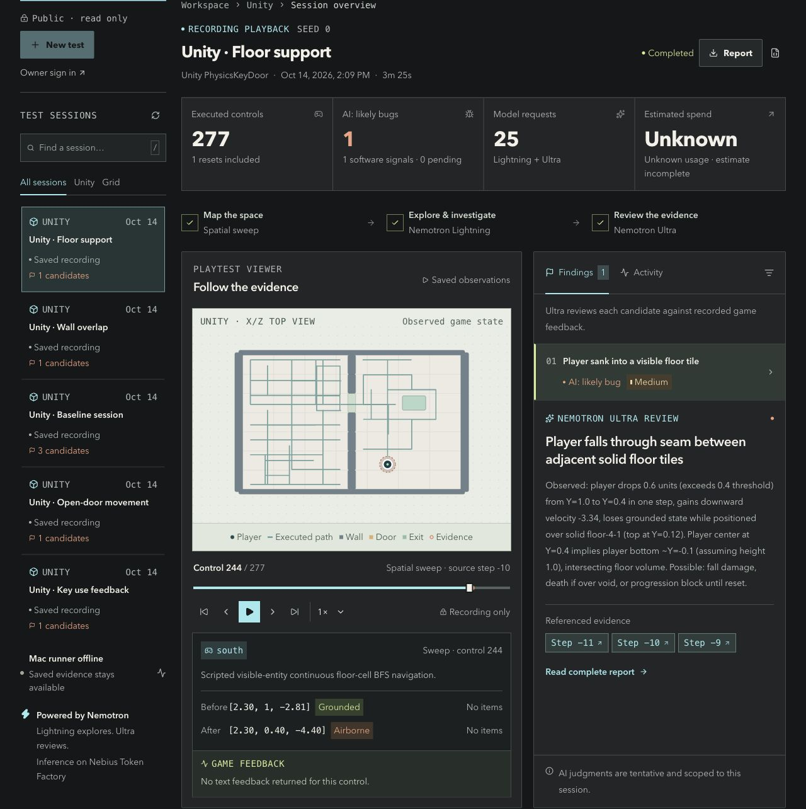

# AutoPlay QA

**Self-Evolving Video Game QA**

Our vision is simple: **the more we test, the more accurate our AI testers
become.** Every useful playthrough should help the next one ask better
questions, recognize real problems, and avoid repeating unhelpful tests.

AutoPlay QA connects NVIDIA Nemotron to games through Nebius Token Factory
and turns testing sessions into evidence developers can inspect, replay,
and build on together.

[Explore the demo](https://autoplay-qa-lab.foomusta.chatgpt.site) ·
[Try it locally](#try-it-locally) ·
[Contribute test data](docs/contributing-data.md) ·
[Community roadmap](docs/research-roadmap.md)



*The local evidence viewer displaying a saved Unity test session and its cited review.*

## Give every test a useful next step

An AI playthrough is most valuable when another developer can understand what
happened and use it again. AutoPlay QA brings the agent's decisions, game
feedback, and reproduction tools into one workflow:

**Play → Record → Review → Reproduce**

- **Follow every decision.** Connect a suspected issue to the controls that ran
  and the game state before and after them.
- **Let AI investigate.** Nemotron chooses exploration actions and reviews
  recorded evidence; prospective hypotheses and control experiments give
  contributors a way to study more purposeful testing.
- **Keep the evidence useful.** Replay saved sessions, inspect cited reports,
  and use reproduction and regression tools to carry findings into development.
- **Build across games.** A shared observation/action interface connects the
  Grid reference game, Unity integrations, and browser workflows.

This is what we want to add to AI testing: a shared body of inspectable
experience that developers and agents can improve together.

## More testing. Better judgment.

By **self-evolving**, we mean a tester that learns from the outcome of its work:
which experiments revealed something useful, which suspicions were mistaken,
and which checks should become part of the next test session.

We want that cycle to produce **more confirmed findings, fewer false alarms,
less wasted repetition, and stronger regression coverage**. Our community
roadmap connects remembered observations, hypothesis-driven experiments,
developer feedback, and reusable test cases toward that goal.

The longer-term ambition is to **co-create open models specialized for games**:
models shaped by real mechanics, player interactions, and carefully reviewed
testing data from the game development community.

## Help build the shared experience

You can contribute without building a model. Share a small, reproducible test:
the game version and starting state, what happened, what you expected and why,
and enough evidence for someone else to check it.

**Normal behavior, disproved suspicions, and corrected AI reports are valuable
too.** Together with confirmed issues and fix checks, they can help future
testers learn when to investigate and when to move on.

Start with the [test-data contribution guide](docs/contributing-data.md) and
[submission template](.github/ISSUE_TEMPLATE/test-data.md). We propose reviewing
small evidence bundles, crediting contributors, and curating reusable examples
for evaluation and, with explicit permission, future model training.

## Try it locally

From the repository root with Python **3.11+**, record a short Grid session:

```sh
python3 -m autoplay_qa play --seed 0 --log runs/my-play.jsonl
```

Use `n`, `s`, `e`, `w`, `i` (interact), and `.` (wait); press `q` to finish.
Then replay and inspect it:

```sh
python3 -m autoplay_qa replay runs/my-play.jsonl
python3 -m autoplay_qa review runs/my-play.jsonl --evidence
```

This local walkthrough needs no API key. Continue with the
[setup guide](docs/getting-started.md) for Nemotron configuration and scripted
benchmarks, or [web setup](web/README.md) to run the evidence viewer.

## Build with us

Contribute an adapter, a reproducible case, a clearer evidence view, or an
experiment that helps agents make better testing decisions.

[Contributing](CONTRIBUTING.md) · [Documentation](docs/README.md) ·
[Research roadmap](docs/research-roadmap.md) · [MIT license](LICENSE)

Created by **Shaun Wang** · [GitHub](https://github.com/ShaunNYC) ·
[LinkedIn](https://www.linkedin.com/in/shaun-wang-3b92222b8)
