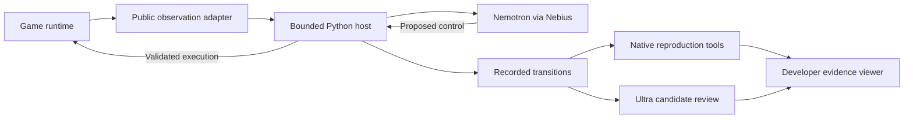

# Architecture and Nemotron

The Python host connects model decisions to native execution and an inspectable
record. The adapter provides public observations and legal controls. The model
chooses a control; the host validates it, executes it, and records the result.

## Model and software responsibilities

| Component | Responsibility |
| --- | --- |
| Nemotron Lightning | Default action selection, brief reasons, optional predictions, and tentative notes |
| Nemotron Ultra | Structured review of candidate evidence; designated actor in the experimental semantic protocol |
| Host | Contracts, dispatch, execution receipts, factual comparisons, recordings, and resource limits |
| Runtime adapter | Public state, native controls, and acknowledgment of execution |
| Reproduction tools | Execute recorded sequences and compare observable behavior in a compatible runtime |
| Developer/reviewer | Decide whether supported behavior conflicts with intended design |

Models run through Nebius Token Factory. The default identifiers are
`nvidia/Nemotron-3_5-Lightning` and `nvidia/Nemotron-3-Ultra-550b-a55b`.
Private evaluation labels and developer rules remain outside actor/reviewer
inputs. The host does not convert a confident model statement into ground truth.

## Why the surrounding framework matters

A direct AI playtesting session can produce actions and explanations. AutoPlay
QA adds a stable interface, execution provenance, source labels, format-specific
reproduction tools, and bounded accounting. A developer can inspect the steps
behind a candidate and compare agent methods using the same runtime boundary.

Scripted checks and contextual exploration coexist in the pipeline. Their
contributions stay distinct rather than attributing all software detection to
the model.

## Code map

- `autoplay_qa/game.py`, `lean.py`, and `runner.py`: reference game and agent loops.
- `protocol.py`, `remote.py`, and `server.py`: local game transport.
- `session.py`, `review.py`, and `reporting.py`: recordings and evidence tools.
- `triage.py`: bounded Ultra review.
- `experience.py` and `adaptive*.py`: scoped facts and experimental context.
- `browser_adapter.py`, `semantic_testing.py`, and `semantic_analysis.py`:
  browser experiments and regression evidence.
- `unity/AutoPlayQA/`: Unity adapter package and samples.
- `web/`: viewer and optional task service.

The web service receives sanitized evidence; the optional local runner holds
provider credentials. Deploying that service requires explicit infrastructure
and authentication configuration. A local viewer build does not launch an
agent or inherit a hosted deployment.
